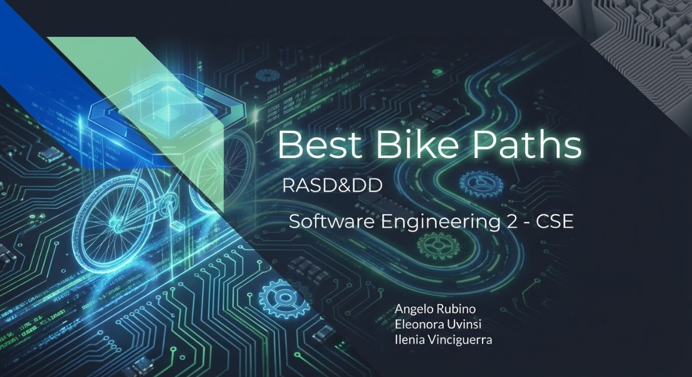
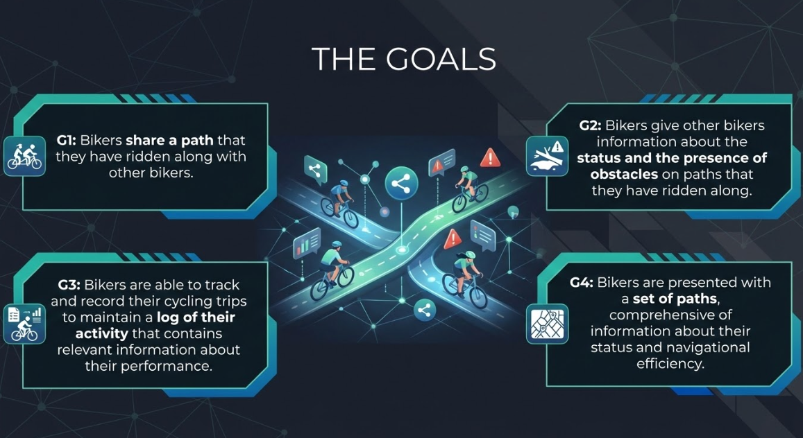
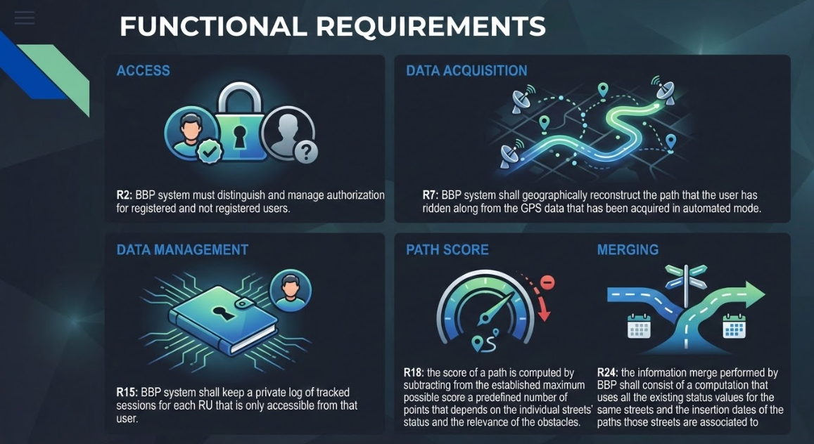
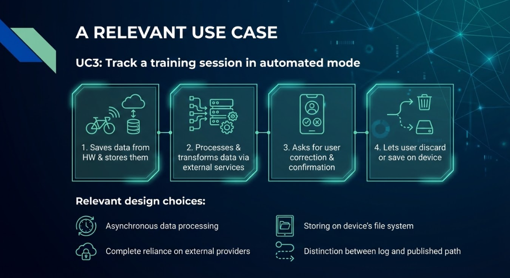
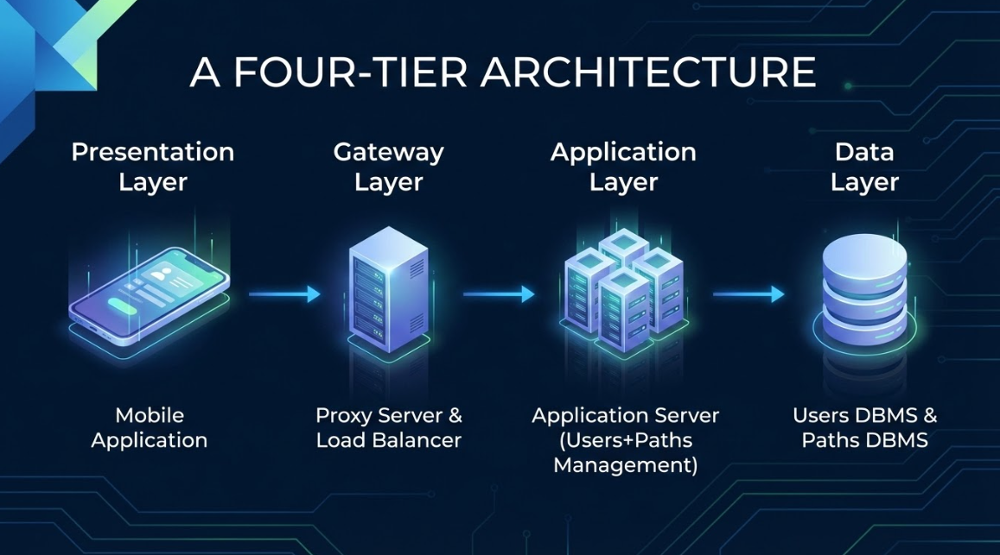
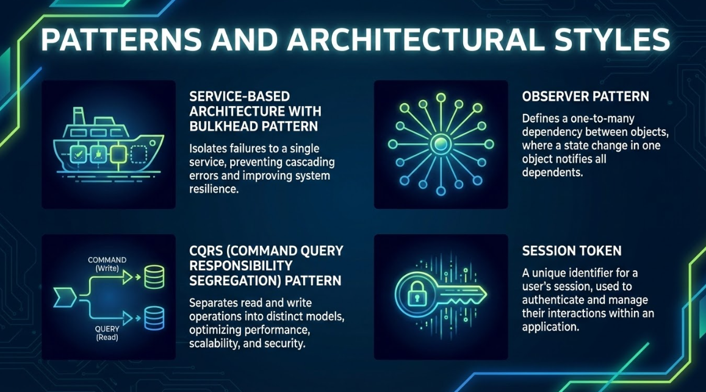
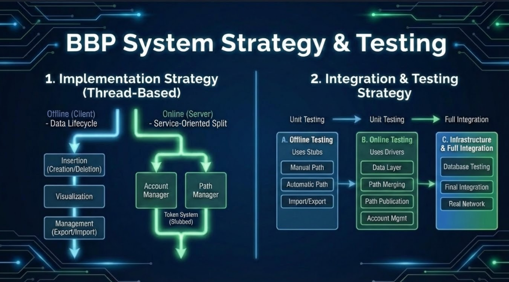

# BBP - Software Engineering Project

<!-- > **BBP** (Best Bike Paths) is a comprehensive software system designed to support sustainable mobility by managing bike paths. -->

## 📄 Overview

This repository hosts the complete software documentation for the BBP project, developed as part of the Software Engineering 2 course. The goal was to perform a complete requirement engineering process and design a suitable architecture.

The project focuses on allowing users to track their bike rides, report obstacles, rate path quality, and receive routing suggestions based on safety and road conditions rather than just distance.

## 📂 Deliverables

| Document | Description | Download |
| :--- | :--- | :---: |
| **RASD** | **Requirement Analysis and Specification Document**. Covers domain analysis, functional/non-functional requirements, use cases, and formal modeling using Alloy. | [Download PDF](./DeliveryFolder/RASDv1.pdf) |
| **DD** | **Design Document**. Details the system architecture, component interfaces, data management, algorithm logic, and deployment strategy. | [Download PDF](./DeliveryFolder/DDv1.pdf) |
|**Alloy Model**| Source Code | [Download](./DeliveryFolder/BBP.als)

---

## 🔍 RASD Highlights (Goals, Requirements)

The Requirements Analysis focused on identifying **World Phenomena**, **Shared Phenomena** and **Domain Assumptions** to build a robust system specification.

## 🔍 RASD Highlights (Goals, Requirements)

The Requirements Analysis focused on identifying **World Phenomena**, **Shared Phenomena**, and **Domain Assumptions** to build a robust system specification.

To visualize the system's behavior, we extensively used **UML standards**:
* **Use Case Diagrams** to define actor boundaries and system interactions.
* **Sequence Diagrams** to capture the behavior of the instances of the main classes that are in the domain class diagram by showing the different status in which they can exist within the system.
* **State Diagrams** to rigorously map the lifecycle of dynamic entities like bike paths and obstacles.
* **Domain Class Diagram** to show the relevant entities in the model and how they relate to each other.

Additionally, to ensure consistency, we employed **Alloy 6** for formal verification. By modeling critical aspects of the domain, we were able to prove assertions and validate our requirements against potential logical conflicts.

The rigorous requirement analysis was complemented by **formal modeling using Alloy 6**. We defined the static structure (Signatures) and dynamic behaviors (Predicates) of the system to simulate critical scenarios.

<!---->

---

## 🏗️ DD Highlights (Architecture)

A crucial part of our design process was ensuring complete **Requirements Traceability**. As detailed in Chapter 4, we established a comprehensive mapping between each Functional Requirement defined in the RASD and the specific software components responsible for satisfying it. This guarantees that every architectural decision is justified by a user need and that no requirement is left unaddressed.

<!---->

---

## 🛠️ Tools Used

* **Modeling:** Draw.io, PlantUML, Alloy 6
* **Writing:** LaTeX
* **Version Control:** Git & GitHub
* **Generative AI:** Google Gemini (used for generating the graphics in this presentation) 

## 👥 Authors

* **Ilenia Vinciguerra** 
* **Eleonora Uvinsi** 
* **Angelo Rubino** 
